# MoE Inference Optimization: Architecture and Method Comparisons

## 1. Introduction

This document presents visual comparisons of alternative architectural approaches and optimization techniques relevant to our Mixture of Experts (MoE) inference system.

The objective is to explain:

* How different approaches work.
* How they differ architecturally and computationally.
* What advantages and disadvantages each approach introduces.
* Which approaches are used in our implementation.
* How the different techniques contribute to memory and compute optimization.

The comparisons are divided into four main areas:

1. MoE architecture and routing.
2. Memory management and optimization.
3. Weight quantization and precision.
4. Computational optimization.

### Important distinction

This document contains both conceptual diagrams and experimental comparisons.

* **Conceptual diagrams** illustrate how different algorithms and architectures operate.
* **Experimental comparisons** should use actual measurements obtained from our implementation and benchmarks.
* **Theoretical alternatives** are included for architectural understanding and should not be interpreted as implemented features.

---

# 2. MoE Architecture and Routing

## 2.1 Dense Feed-Forward Network vs Mixture of Experts

### Dense Feed-Forward Network

In a conventional Transformer architecture, each token passes through the same feed-forward network.

Every token activates the same set of FFN weights.

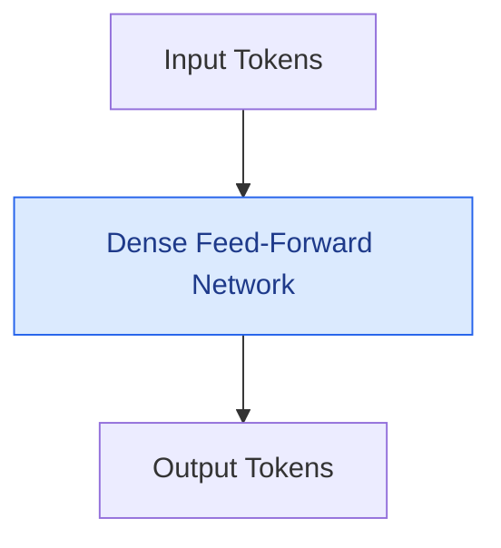

### Mixture of Experts

In an MoE architecture, the dense FFN is replaced by multiple expert networks and a routing mechanism.

The router determines which experts process each token.

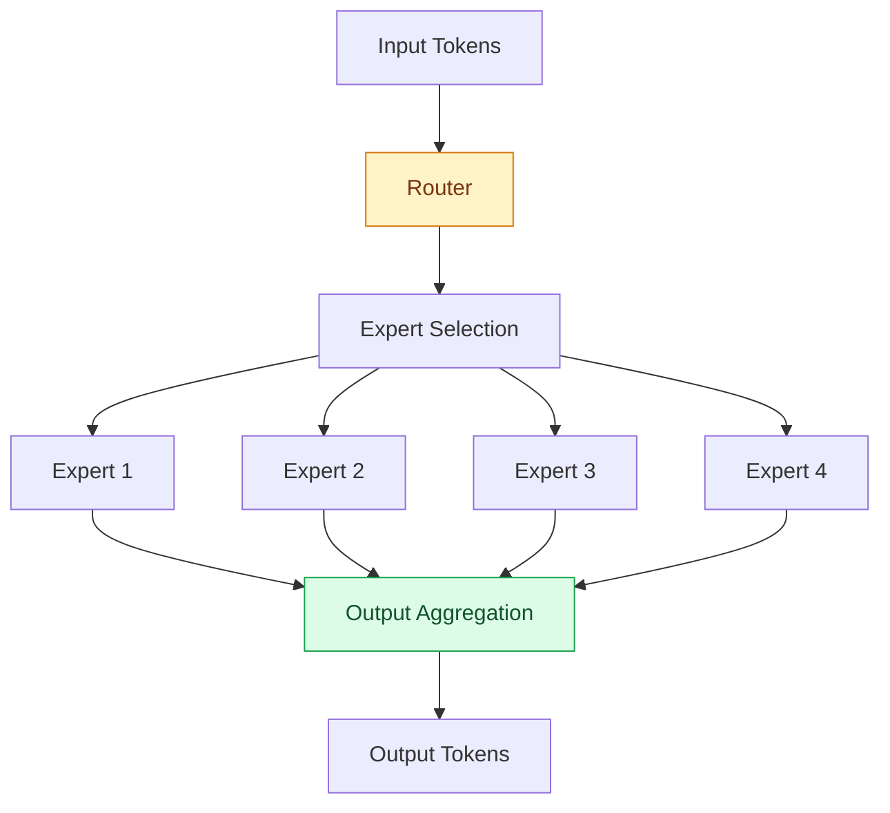

### Comparison

| Property            | Dense FFN                         | MoE                                  |
| ------------------- | --------------------------------- | ------------------------------------ |
| Network structure   | One shared FFN                    | Multiple expert networks             |
| Expert selection    | Not required                      | Router selects experts               |
| Active parameters   | All FFN parameters                | Selected experts' parameters         |
| Computational cost  | Depends on the full FFN           | Depends on selected experts          |
| Parameter capacity  | Limited by the dense network size | Can scale through additional experts |
| Memory requirements | Stores dense FFN weights          | Must manage multiple expert weights  |

### Advantages and Trade-offs

**Dense FFN**

Advantages:

* Simpler architecture.
* Straightforward execution.
* No routing overhead.

Disadvantages:

* All FFN parameters participate in computation.
* Scaling model capacity increases computation.

**MoE**

Advantages:

* Larger total parameter capacity.
* Only selected experts need to participate in each token's computation.
* Offers opportunities for sparse computation.

Disadvantages:

* Requires routing and token dispatch.
* Expert weights introduce additional memory-management requirements.
* Uneven expert utilization can create bottlenecks.

### Relevance to Our Project

Our project focuses on optimizing MoE inference, particularly the memory and computational costs associated with loading, storing, selecting and executing experts.

---

## 2.2 Expert Routing: Top-1 vs Top-2 vs Top-K

The router calculates scores for available experts and determines which experts should process each token.

The routing process generally involves:

1. Calculating router logits.
2. Applying softmax to obtain routing probabilities.
3. Selecting the highest-scoring experts.
4. Dispatching tokens to the selected experts.
5. Combining expert outputs using routing weights.

### Top-1 Routing

Only the expert with the highest routing probability is selected.

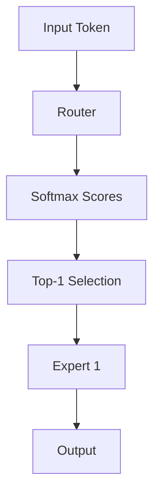

### Top-2 Routing

The two highest-scoring experts are selected.

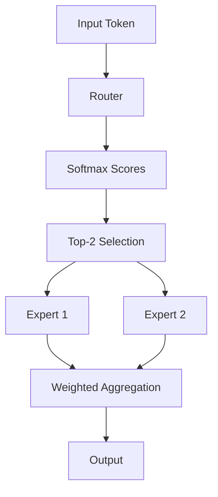

### General Top-K Routing

The router selects K experts from the available expert pool.

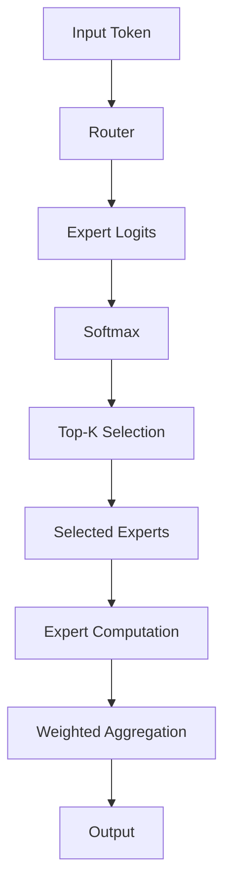

### Comparison

| Property              | Top-1              | Top-2                     | Top-K                     |
| --------------------- | ------------------ | ------------------------- | ------------------------- |
| Selected experts      | 1                  | 2                         | K                         |
| Computation per token | Lower              | Higher                    | Depends on K              |
| Routing complexity    | Lower              | Moderate                  | Depends on K              |
| Expert participation  | One expert         | Two experts               | Multiple experts          |
| Aggregation           | Usually one output | Multiple weighted outputs | Multiple weighted outputs |

### Relevance to Our Project

Our implementation uses softmax-based expert scoring followed by Top-K selection.

The selected experts process the tokens, and their outputs are combined using routing weights.

The choice of K influences the number of experts activated per token and consequently affects computational requirements.

---

# 3. Memory Management and Optimization

## 3.1 Conventional Weight Loading vs Memory Mapping (mmap)

Large MoE models contain many expert weights.

Loading all weights into physical memory at initialization can create significant RAM requirements.

Memory mapping provides an alternative by mapping weight files into a process's virtual address space.

### Conventional Loading

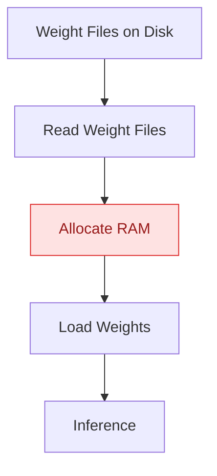

### Memory Mapping

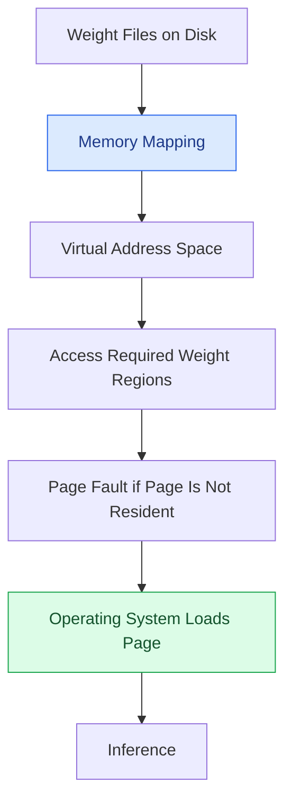

### Comparison

| Property           | Conventional Loading                           | Memory Mapping                  |
| ------------------ | ---------------------------------------------- | ------------------------------- |
| Initial loading    | Explicitly loads weights                       | Maps file into virtual memory   |
| Memory allocation  | Typically allocates storage for loaded weights | Uses file-backed virtual memory |
| Access             | Through loaded memory buffers                  | Through mapped memory regions   |
| Loading behavior   | Often loads the complete requested dataset     | Pages can be loaded on demand   |
| Memory management  | Application manages loading and buffers        | OS manages mapped pages         |
| Potential overhead | Large initialization and memory allocation     | Page faults and disk I/O        |

### Advantages and Trade-offs

**Conventional loading**

Advantages:

* Predictable access after loading.
* Straightforward implementation.
* Can be efficient when sufficient RAM is available.

Disadvantages:

* High initial memory requirements.
* Large loading operations.
* May load weights that are not immediately needed.

**Memory mapping**

Advantages:

* Avoids explicitly loading the entire mapped file into application-managed buffers.
* Supports demand paging.
* Allows the operating system to manage file-backed pages.

Disadvantages:

* Page faults can introduce latency.
* Disk I/O can become a bottleneck.
* Performance depends on the access pattern and available memory.

### Relevance to Our Project

We use memory-mapped weight loading to improve the management of large model weights.

The purpose is to reduce unnecessary upfront loading and make weight access more memory-efficient.

---

## 3.2 Expert Caching: LRU vs LFU vs Belady

When expert weights cannot all remain in RAM, an expert cache can maintain a smaller collection of frequently or recently accessed experts.

When the cache becomes full and another expert needs to be loaded, an eviction policy determines which expert should be removed.

### LRU: Least Recently Used

LRU removes the expert that has not been accessed for the longest time.

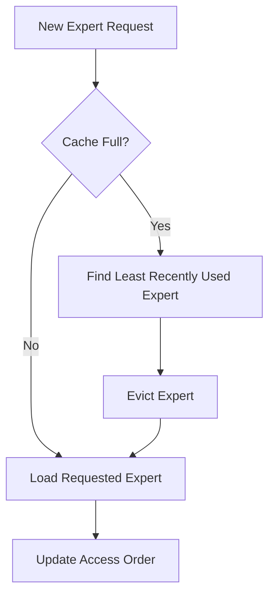

### LFU: Least Frequently Used

LFU removes the expert with the lowest access frequency.

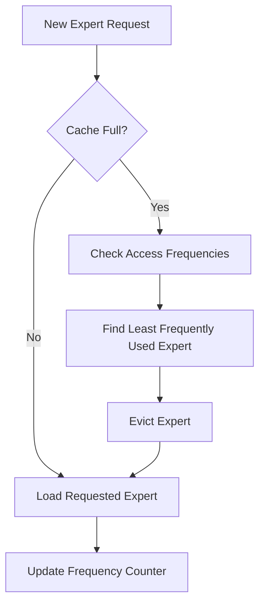

### Belady's Optimal Replacement

Belady's algorithm evicts the cached item whose next use is farthest in the future.

It requires knowledge of future requests, making it an offline optimal benchmark rather than a generally deployable online policy.

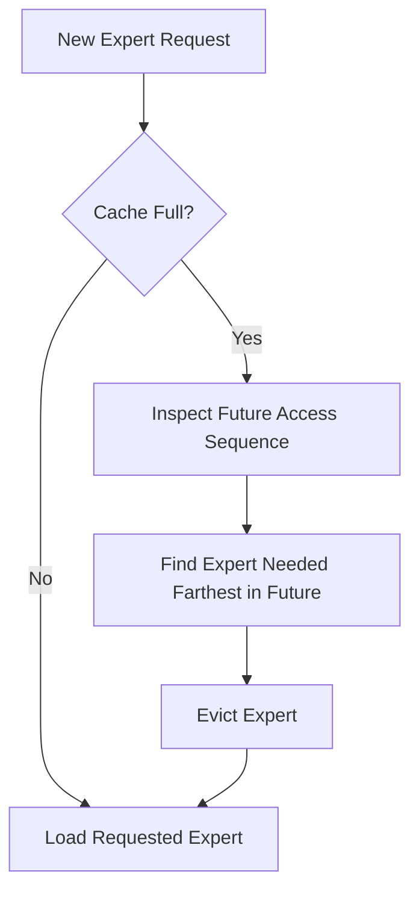

### Comparison

| Property                  | LRU                                   | LFU                                          | Belady                                            |
| ------------------------- | ------------------------------------- | -------------------------------------------- | ------------------------------------------------- |
| Replacement criterion     | Recency                               | Frequency                                    | Future access                                     |
| Requires access history   | Yes                                   | Yes                                          | Yes                                               |
| Requires future knowledge | No                                    | No                                           | Yes                                               |
| Online implementation     | Yes                                   | Yes                                          | No, not in its optimal form                       |
| Main advantage            | Simple and responsive to recent usage | Retains frequently accessed experts          | Optimal misses for a known fixed request sequence |
| Main limitation           | Can evict frequently used experts     | Can retain experts that are no longer useful | Requires knowledge of future requests             |

### Example

Assume a cache contains three experts:

```text
+----------+----------+----------+
| Expert A | Expert B | Expert C |
+----------+----------+----------+
```

A new expert, D, is requested.

* LRU examines which expert was accessed longest ago.
* LFU examines which expert has the lowest access frequency.
* Belady examines which expert will be needed farthest in the future.

The three algorithms may choose different experts for eviction because they use different information.

### Experimental Comparison

The following metrics should be used when comparing cache policies:

| Metric               | Description                                     |
| -------------------- | ----------------------------------------------- |
| Cache hit rate       | Percentage of requests served from cache        |
| Cache miss rate      | Percentage of requests requiring an expert load |
| Eviction count       | Number of experts removed from cache            |
| Expert loading count | Number of expert loading operations             |
| Memory utilization   | Amount of memory occupied by cached experts     |

A fair comparison requires the same expert request sequence, cache capacity and initial cache state.

### Relevance to Our Project

Our cache replacement strategies address the problem of managing a limited amount of memory when the complete expert pool cannot remain resident.

Belady provides a useful optimal reference against which online replacement policies can be evaluated.

---

# 4. Weight Quantization and Precision Optimization

## 4.1 FP16 vs INT8 vs INT4

Quantization reduces the number of bits required to represent model weights.

Lower precision reduces storage requirements but introduces quantization error.

### Weight Representation

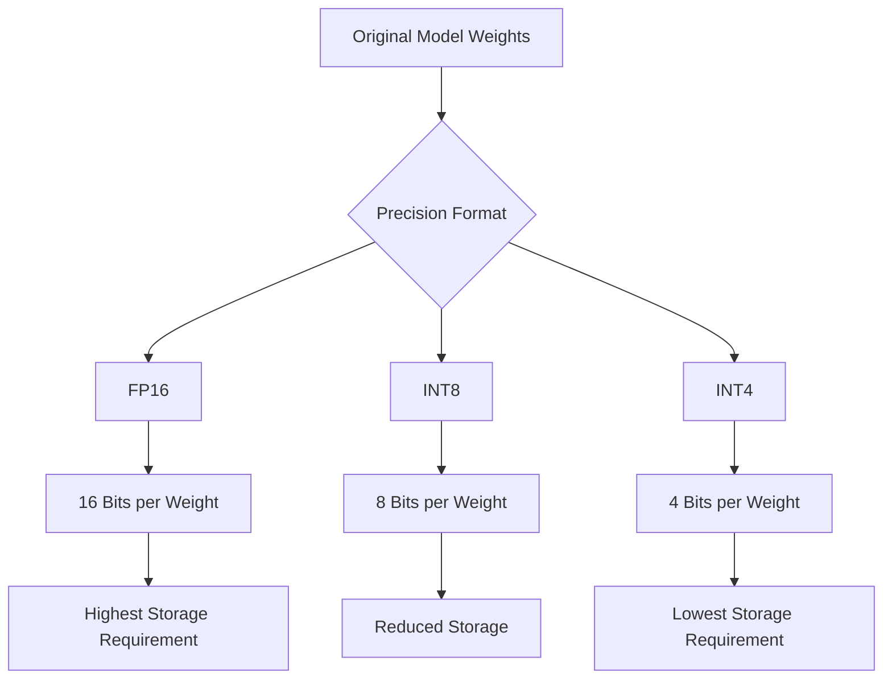

### Relative Storage Comparison

For the same number of weights:

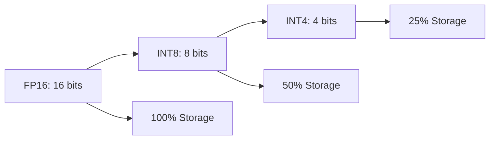

### Comparison

| Property                      |                           FP16 |                    INT8 |                    INT4 |
| ----------------------------- | -----------------------------: | ----------------------: | ----------------------: |
| Bits per weight               |                             16 |                       8 |                       4 |
| Relative storage              |                           100% |                     50% |                     25% |
| Quantization conversion error | None from FP16-to-FP16 storage | Depends on quantization | Depends on quantization |
| Storage efficiency            |                         Lowest |                  Higher |                 Highest |
| Precision                     |                         Higher |                   Lower |                   Lower |

The storage percentages are theoretical comparisons for equal numbers of weights, excluding metadata, scales, zero-points, alignment and packing overhead.

### Advantages and Trade-offs

**FP16**

* Higher numerical precision.
* Larger memory footprint.
* Useful as a reference representation.

**INT8**

* Reduces weight storage by approximately 50% compared with FP16.
* Generally offers a balance between storage and precision.
* Requires quantization and dequantization or compatible integer computation.

**INT4**

* Reduces raw weight storage by approximately 75% compared with FP16.
* Provides higher compression.
* Can introduce greater quantization error.
* Requires careful handling of packing and unpacking.

### Relevance to Our Project

Our implementation includes block-wise INT8 and INT4 quantization.

Block-wise quantization applies quantization parameters to groups of weights rather than necessarily using one global scale for the entire tensor.

This allows different blocks to represent their local numerical ranges more effectively.

---

## 4.2 Uniform vs Mixed-Precision Quantization

Different model components may have different sensitivities to quantization error.

Uniform quantization applies the same precision format to all selected weight matrices.

Mixed-precision quantization assigns different precision formats to different components.

### Uniform Precision

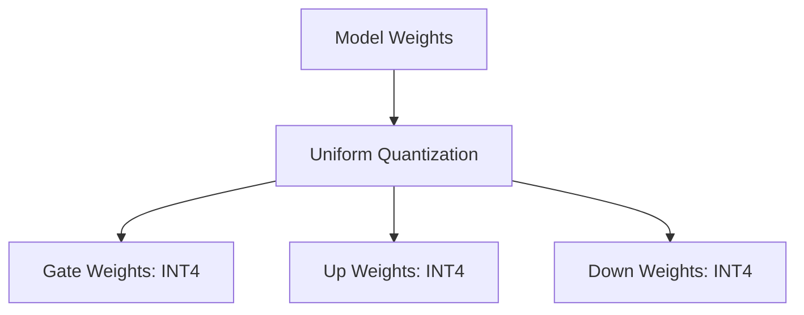

### Mixed Precision

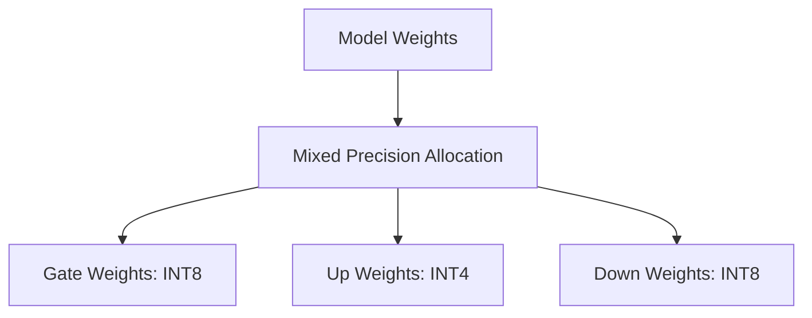

### Comparison

| Property                 | Uniform Precision                          | Mixed Precision                       |
| ------------------------ | ------------------------------------------ | ------------------------------------- |
| Precision allocation     | Same precision across selected matrices    | Different precision per component     |
| Implementation           | Simpler                                    | More complex                          |
| Memory optimization      | Consistent                                 | Can be more targeted                  |
| Quantization sensitivity | Does not account for component differences | Can account for component differences |
| Configuration            | Straightforward                            | Requires sensitivity analysis         |

### Relevance to Our Project

Mixed precision is an important alternative when investigating how to balance memory reduction and numerical accuracy.

Any mixed-precision configuration must be evaluated experimentally before claiming that it improves the overall system.

---

## 4.3 INT4 Packing: Unpacked vs Packed Representation

INT4 values require four bits each.

However, ordinary byte-addressable memory stores data in units of at least eight bits.

Packing allows two INT4 values to occupy a single byte.

### Unpacked Representation

```text
Weight A: 0000 1010
Weight B: 0000 0011

Total: 16 bits = 2 bytes
```

### Packed Representation

```text
+----------------+----------------+
| Weight A: 1010 | Weight B: 0011 |
+----------------+----------------+

Total: 8 bits = 1 byte
```

### Visual Comparison

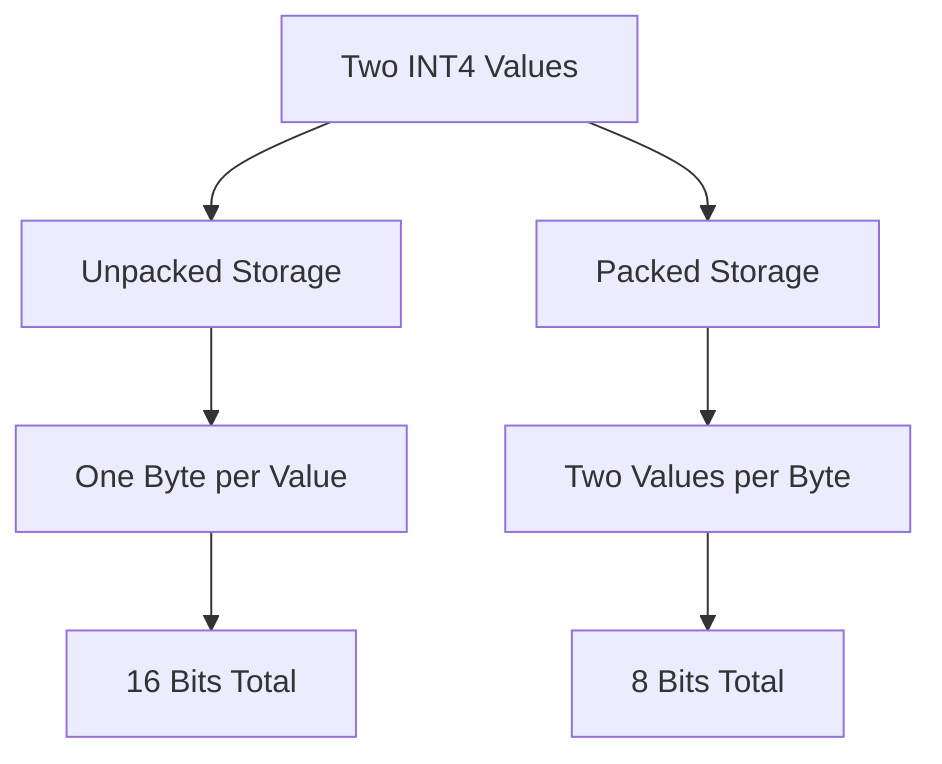

### Comparison

| Property              | Unpacked INT4                        | Packed INT4                |
| --------------------- | ------------------------------------ | -------------------------- |
| Values per byte       | One stored in a byte-sized container | Two                        |
| Storage efficiency    | Lower                                | Higher                     |
| Memory footprint      | 2 bytes for two values               | 1 byte for two values      |
| Access complexity     | Simpler                              | Requires nibble extraction |
| Additional operations | Fewer unpacking operations           | Bit manipulation required  |

### Relevance to Our Project

INT4 packing complements block-wise quantization by reducing the physical storage required for quantized weights.

Packing and unpacking must be handled correctly to preserve the signed INT4 representation.

---

# 5. Computational Optimization

## 5.1 Naive vs Tiled Matrix Multiplication

Matrix multiplication is a fundamental operation in neural network inference.

A naive implementation may repeatedly access matrix elements from memory.

Tiled matrix multiplication divides matrices into smaller blocks, allowing data to be reused during computation.

### Naive Matrix Multiplication

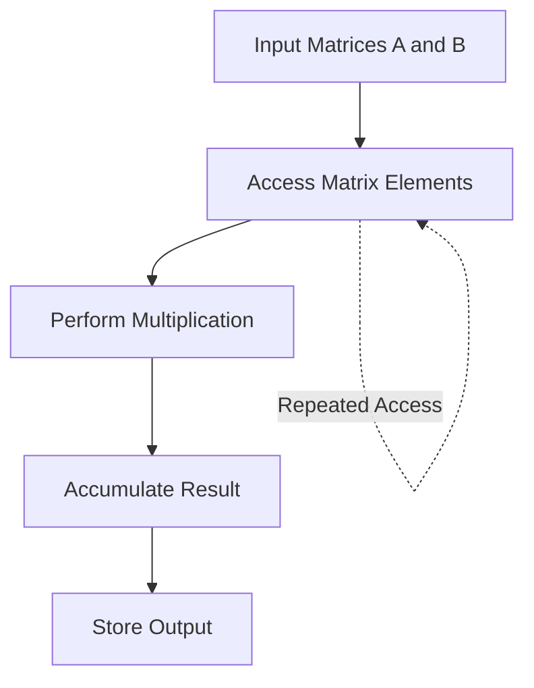

### Tiled Matrix Multiplication

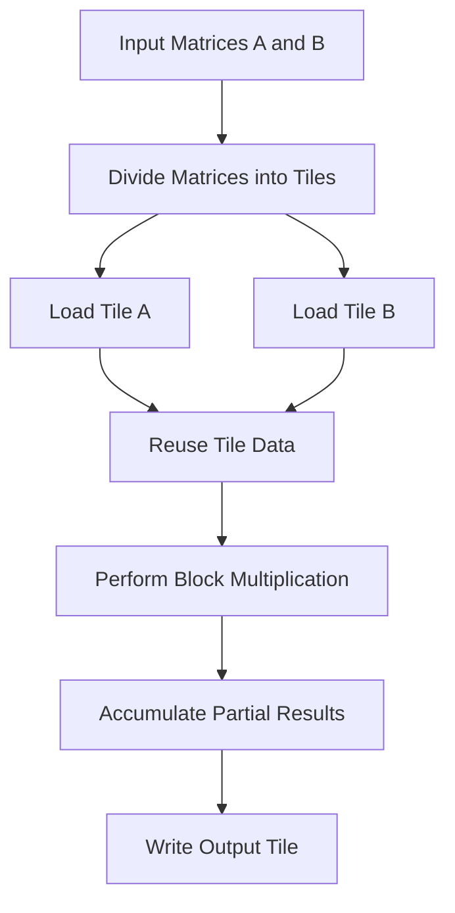

### Comparison

| Property       | Naive                                             | Tiled                                           |
| -------------- | ------------------------------------------------- | ----------------------------------------------- |
| Computation    | Element-wise or straightforward matrix operations | Block-based matrix operations                   |
| Memory access  | Potentially repeated accesses                     | Promotes data reuse                             |
| Data locality  | Less controlled                                   | Improved through tiling                         |
| Implementation | Simpler                                           | More complex                                    |
| Performance    | Depends on implementation                         | Can improve performance when properly optimized |

### Tile Size

Different tile sizes can influence memory reuse and computational performance.

For example:

* Tile size 8.
* Tile size 16.
* Tile size 32.

Larger tiles are not automatically better. The optimal size depends on the hardware, memory hierarchy, matrix dimensions and implementation.

### Existing Experimental Comparison

Our transaction-counting experiment produced the following results:

| Approach   | Memory Transactions |
| ---------- | ------------------: |
| Naive      |              40,960 |
| Tiled (8)  |               8,192 |
| Tiled (16) |               4,096 |

These are results from the transaction-counting experiment, not measured GPU execution times.

The experiment demonstrates how tiling can reduce modeled memory transactions through improved data reuse.

### Relevance to Our Project

Tiled matrix multiplication is relevant to the compute optimization component of our project because it demonstrates how organizing computation around reusable blocks can reduce memory-access overhead.

---

## 5.2 Individual vs Grouped Expert Computation

In MoE inference, tokens are routed to different experts.

If each token is processed independently, the system may perform many small operations.

Grouped execution organizes tokens by their assigned experts and performs batched computations.

### Individual Expert Execution

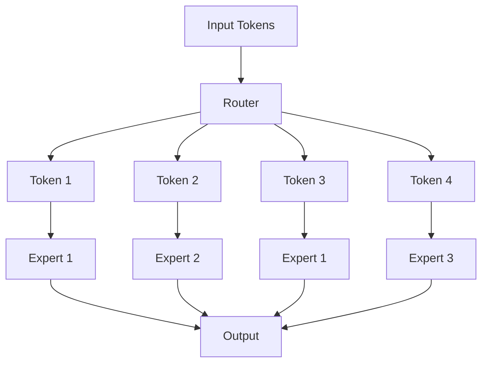

### Grouped Expert Execution

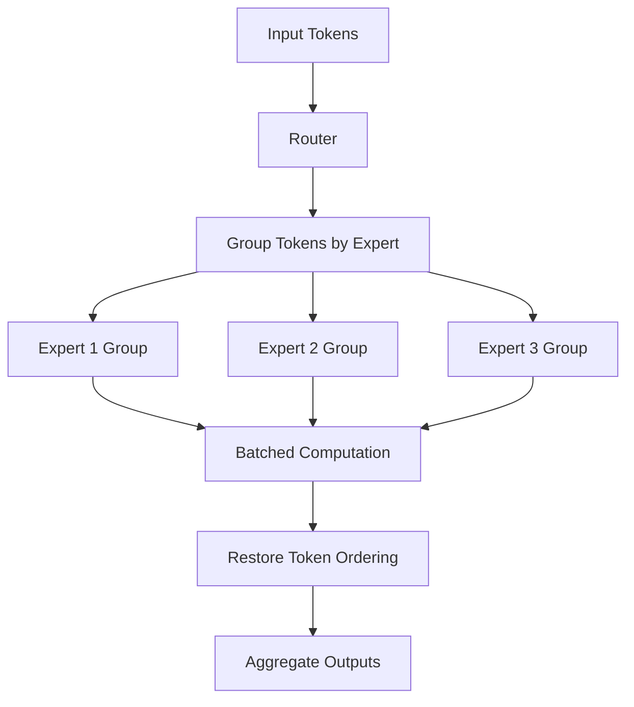

### Comparison

| Property           | Individual Execution              | Grouped Execution                    |
| ------------------ | --------------------------------- | ------------------------------------ |
| Token processing   | Separately                        | Organized into expert groups         |
| Matrix operations  | Potentially many small operations | Batched operations                   |
| Data organization  | Individual token dispatch         | Grouped token dispatch               |
| Execution overhead | Can be higher                     | Can reduce repeated overhead         |
| Implementation     | Simpler                           | Requires grouping and dispatch logic |
| Main challenge     | Small operations and overhead     | Group imbalance and reordering       |

### Relevance to Our Project

Grouped computation is relevant to MoE inference because multiple tokens may select the same expert.

Grouping these tokens can create opportunities for more efficient batched matrix multiplication.

However, grouping introduces its own overhead, so the actual benefit depends on token distribution, batch size and implementation.

---

# 6. Integrated Optimization Pipeline

The techniques discussed above address different parts of the inference process.

They should not be viewed as competing optimizations in every case. Several can work together.

The following diagram illustrates how they relate to the overall MoE inference pipeline.

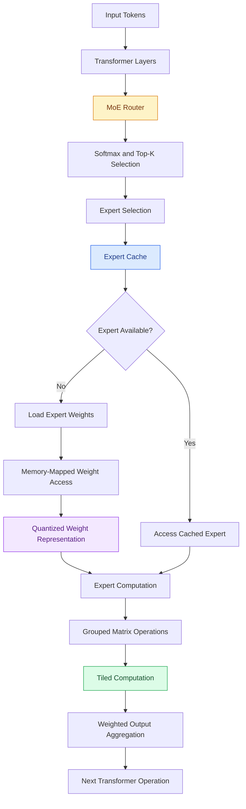

### Optimization Responsibilities

| Technique                   | Main Problem Addressed                           |
| --------------------------- | ------------------------------------------------ |
| Top-K routing               | Limits the number of activated experts           |
| Expert caching              | Reduces repeated expert loading                  |
| mmap                        | Supports demand-based access to weight files     |
| INT8 quantization           | Reduces weight storage                           |
| INT4 quantization           | Further reduces weight storage                   |
| INT4 packing                | Stores two quantized values per byte             |
| Grouped computation         | Organizes tokens for batched expert execution    |
| Tiled matrix multiplication | Improves data reuse and memory-access efficiency |

---

# 7. Performance Evaluation and Comparison Metrics

Architectural differences alone are insufficient to establish which approach is better.

Each optimization should be evaluated using metrics relevant to the problem it addresses.

| Optimization Area     | Recommended Evaluation Metrics                                     |
| --------------------- | ------------------------------------------------------------------ |
| Weight loading        | Loading time, peak RAM, resident memory, page faults               |
| Expert caching        | Hit rate, miss rate, evictions, expert loading time                |
| Quantization          | Weight size, memory usage, quantization error, inference quality   |
| INT4 packing          | Storage size, packing/unpacking overhead                           |
| Matrix multiplication | Execution time, memory transactions, throughput                    |
| Grouped computation   | Execution time, batch utilization, dispatch overhead               |
| Overall inference     | Tokens per second, time to first token, peak memory, total latency |

### Important Experimental Considerations

For fair comparisons:

1. Use the same model configuration.
2. Keep the input workload consistent.
3. Keep batch size constant where applicable.
4. Use the same hardware and software environment.
5. Record memory consumption consistently.
6. Distinguish cold-start performance from warm inference.
7. Repeat measurements where appropriate.
8. Report averages and variability rather than relying on a single measurement.

---

# 8. Design Decisions and Trade-offs

The purpose of these comparisons is not to assume that one optimization is always superior.

Each method addresses a different bottleneck.

| Problem               | Alternative Approaches       | Main Decision Factor                      |
| --------------------- | ---------------------------- | ----------------------------------------- |
| Expert activation     | Dense FFN vs MoE             | Computational sparsity and model capacity |
| Expert selection      | Top-1 vs Top-2 vs Top-K      | Active computation and routing behavior   |
| Weight loading        | Conventional loading vs mmap | Memory requirements and access patterns   |
| Expert replacement    | LRU vs LFU vs Belady         | Expert access distribution                |
| Weight precision      | FP16 vs INT8 vs INT4         | Memory reduction and numerical accuracy   |
| Precision allocation  | Uniform vs mixed precision   | Component sensitivity                     |
| INT4 representation   | Unpacked vs packed           | Storage efficiency and access overhead    |
| Matrix multiplication | Naive vs tiled               | Data reuse and memory transactions        |
| Expert execution      | Individual vs grouped        | Batching efficiency and dispatch overhead |

## Final Perspective

The optimizations in an MoE inference system operate at different levels:

* **Architecture level:** Determines which experts participate in computation.
* **Memory-management level:** Determines how expert weights are loaded and retained.
* **Representation level:** Determines how many bits are used to store weights.
* **Execution level:** Determines how efficiently mathematical operations are performed.

Combining these approaches can improve the efficiency of MoE inference, but their individual and combined effects must be established through controlled experiments.

The central objective is to reduce memory and computational overhead while preserving the correctness of model inference.
